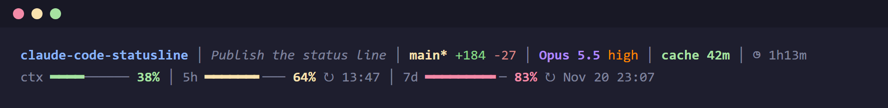

# claude-code-statusline

A two-line status line for [Claude Code](https://code.claude.com/docs/en/statusline): where you are, what
model you are using, and how much context and usage you have left, at a glance.



## What it shows

**Line 1**

| Segment | Details |
| --- | --- |
| Directory | Name of the current working directory. |
| Session | Session name, set with `--name` or `/rename`, or the auto-generated title. Truncated to 30 characters. |
| Git | Branch, `*` when the tree has uncommitted changes, `↑n` / `↓n` commits ahead of or behind upstream, and the lines added / removed during the session. |
| Model | Model name, colored by family (Opus, Sonnet, Haiku, Fable), followed by the effort level. |
| Cache | Minutes left before the prompt cache expires: green above 10, yellow at 10 or less, gray when cold. Requires Claude Code v2.1.251 or later. |
| Duration | Session duration (`◷ 1h13m`). |

**Line 2**

| Segment | Details |
| --- | --- |
| `ctx` | Context window usage. |
| `5h` | Five-hour usage limit, with reset time (`↻ 13:35`). Pro, Max and Ultra subscriptions only. |
| `7d` | Seven-day usage limit, with reset date and time (`↻ Nov 20 22:55`). Pro, Max and Ultra subscriptions only. |
| `spend` | Spend limit, with dollars used and reset date (`$17/$50 ↻ Nov 27 21:47`). Only behind a Claude apps gateway that sets one; requires Claude Code v2.1.251 or later. |

Bars are green below 50%, yellow from 50% and red from 80%. Any segment whose data Claude Code does not
provide is hidden, and the second line disappears entirely when it is empty.

## Requirements

- `bash`
- `jq`
- `git` (optional, only for the Git segment)
- GNU or BSD `date`

Tested on Linux (WSL2). macOS should work, since the script supports BSD `date`, but it has not been
tested yet; reports are welcome. On Windows, use it from WSL.

## Installation

```sh
curl -fsSL https://raw.githubusercontent.com/alefiengo/claude-code-statusline/main/install.sh | bash
```

The installer:

- Checks that `jq` is installed.
- Downloads `statusline.sh` from the [latest release](https://github.com/alefiengo/claude-code-statusline/releases/latest)
  into `~/.claude`, or into `$CLAUDE_CONFIG_DIR` if you set it. To install a specific release, use
  `| STATUSLINE_VERSION=v1.0.0 bash`.
- Adds the `statusLine` block to `settings.json` and leaves every other setting untouched.
- Backs up any file it replaces, with a `.bak-<date>` suffix.
- Asks before replacing a status line you already have. Add `-s -- --yes` after `bash` to skip the
  question.

Restart Claude Code when it finishes. To read the installer before running it, download
[`install.sh`](install.sh) first.

### Manual installation

1. Download the script from the latest release:

   ```sh
   curl -fsSL -o ~/.claude/statusline.sh \
     https://github.com/alefiengo/claude-code-statusline/releases/latest/download/statusline.sh
   chmod +x ~/.claude/statusline.sh
   ```

2. Add this to `~/.claude/settings.json`:

   ```json
   "statusLine": {
     "type": "command",
     "command": "bash ~/.claude/statusline.sh",
     "refreshInterval": 60
   }
   ```

   Claude Code only redraws the status line when something happens in the session. `refreshInterval`
   also redraws it every 60 seconds, so the cache countdown and the session duration stay current while
   the session is idle.

3. Restart Claude Code.

## Customization

- **Colors**: edit the `Palette` block and the `model_color`, `effort_color` and `level_color` functions.
  Values are ANSI SGR codes (`1;34`, `38;5;141`, ...).
- **Order and layout**: reorder or remove entries in the `LINE1` and `LINE2` arrays at the end of the
  script.
- **New segments**: write a function `seg_<name>` that prints its text, or nothing when it does not apply,
  and add it to `LINE1` or `LINE2`. Separators are inserted automatically.

  ```bash
  seg_hello() { paint '1;35' 'hello'; }
  LINE1=(seg_dir seg_git seg_model seg_cache seg_duration seg_hello)
  ```

## Testing

The script reads Claude Code's JSON from standard input, so you can try changes without restarting:

```sh
echo '{"model":{"display_name":"Opus 5.5"},"effort":{"level":"high"},"context_window":{"used_percentage":42}}' \
  | bash statusline.sh
```

## Contributing

Issues and pull requests are welcome. See [CONTRIBUTING.md](CONTRIBUTING.md).

## License

[MIT](LICENSE)
